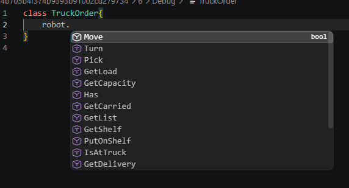
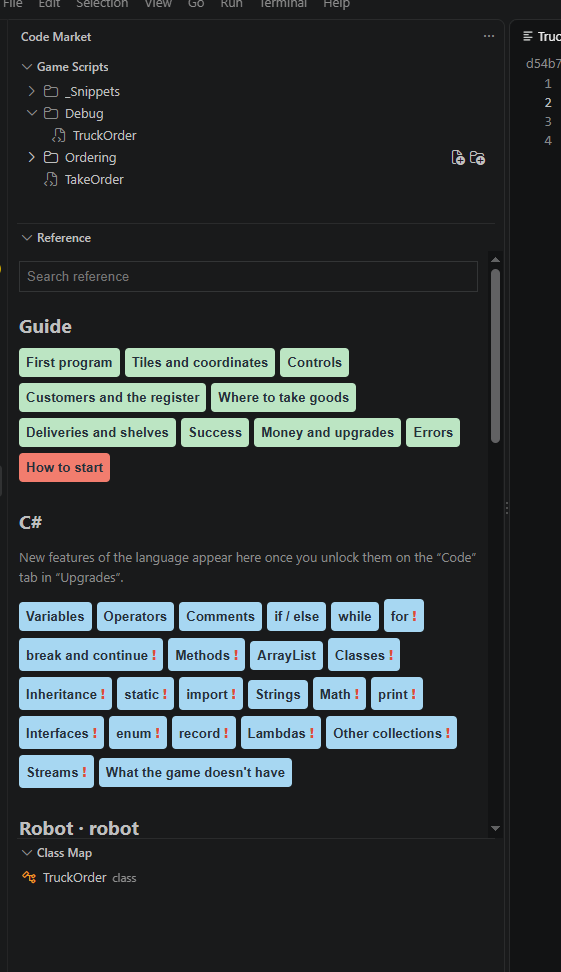
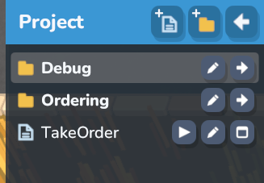

# Code Market Live for VS Code

Edit a running Code Market world's scripts in VS Code through [CMIDE Bridge](https://github.com/CodeMarketModding/CMIDE-Bridge).

## Screenshots

**Upgrade-aware completion in VS Code**

**Game scripts, reference, and Class Map in the VS Code sidebar**

**Code Market's in-game project view**

- Browse game folders; create, rename, delete, and drag scripts between folders or to the tree root. Create folders, including `_` folders hidden in the game explorer.
- Edit game scripts as VS Code documents. Changes sync automatically, and external game changes reload when the document is clean. Conflicting writes stop so your editor text stays available.
- Use the game's C# or Java syntax, automatic braces and indentation, and upgrade-aware completion. Press Ctrl+Space to request suggestions. Inline ghost text, word suggestions, and snippets are disabled by default for Code Market scripts so they do not get mixed with unlocked game results.
- Browse the unlocked in-game reference in the Code Market sidebar. Ctrl-click a supported symbol to open its reference; the regular VS Code hover also provides a reference link.
- Use the Class Map sidebar for an outline of the active game script. VS Code provides the dark theme, editing controls, and local-file handling.
- Optionally enable **Code Market: Local Completions** for basic unfiltered SDK suggestions in ordinary C# and Java files. Local files are never synchronized to the game.

## Install

1. Install [CMIDE Bridge](https://github.com/CodeMarketModding/CMIDE-Bridge/releases/latest) version 1.0.9 or newer and BepInEx 5 for Unity Mono.
2. Download the VSIX from [Releases](https://github.com/CodeMarketModding/CMIDE-VSCode/releases/latest), then install it with `code --install-extension codemarket-live-0.1.4.vsix` or **Extensions: Install from VSIX** in VS Code.
3. Start Code Market and load a world. In VS Code, select the Code Market activity-bar icon and click the refresh icon, or run **Code Market: Connect / Refresh**.
4. Select a script from **Game Scripts**. The connected world's language and upgrades determine completion and reference results.

## Sync and conflicts

Automatic sync is on by default and can be disabled with **Code Market: Auto Sync**. Save a game document to sync manually. If the game or another editor changes a script before your changes are sent, the bridge rejects the write. Your unsynced VS Code text remains open: copy it before reconnecting or reopening the game version. **Code Market: Retry Sync** retries only if the original game text still matches.

Reconnect after switching worlds. Documents from an earlier session or world cannot write into the newly connected world. New File and New Folder use the selected folder when invoked from its context menu; the toolbar buttons use the project root. In **Game Scripts**, click the trash icon on a folder row or right-click the folder and choose **Delete Folder**. Click **Delete** in the confirmation dialog to permanently remove the folder and everything inside it. Save any unsynced edits in the folder before deleting. Folder deletion requires Code Market 1.1 or later and CMIDE Bridge 1.0.11 or later.

The updated game also offers other languages; this extension currently supports C# and Java worlds only and will explain if the selected world uses another language.

Drag a script onto a folder to move it, or onto empty space in **Game Scripts** to move it to the project root. Save unsynced changes before moving. The move is rejected if the destination already contains a file or folder with the same name. Dragging folders is not supported.

The Class Map is a lightweight outline and may omit complex or incomplete declarations. Reference map drawings use simplified icons. Ctrl-click opens a read-only reference document and updates the Reference sidebar; this is how VS Code handles definition navigation.

## Develop and package

This extension targets desktop VS Code on Windows and uses local file-based bridge IPC. Run `npm test` for the isolated unit tests. To package it, use `npx @vscode/vsce package`. The included SDK files are references, not runtime implementations.
